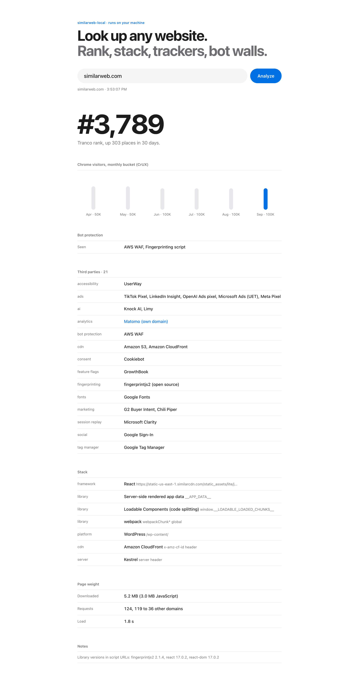

# similarweb-local

Similarweb, rebuilt in a day, running on your machine. Type a domain and get how popular it is, what it's built with, every tracker and ad pixel it loads, and what bot wall it hides behind. Takes about 8 seconds.

<picture>
  <source media="(prefers-color-scheme: dark)" srcset="docs/app-desktop-dark.png">
  
</picture>

Free and open source, about 930 lines of TypeScript. No API keys and no account. Popularity comes from two public research datasets, and everything else comes from loading the page once in your own Chrome.

## Quick start

```sh
git clone https://github.com/eliotb26/similarweb-local.git && cd similarweb-local
npm install
node src/cli.ts notion.com
```

You need Node 23.6 or newer (it runs the TypeScript directly) and Google Chrome. Set `SWL_CHROME=/path/to/chrome` if Chrome lives somewhere unusual.

```
  notion.com  ·  The AI workspace that works for you. | Notion

  Popularity
  Tranco rank      #1,436 (up 221 over 30 days)
  Chrome (CrUX)    Apr top 50K → May top 50K → Jun top 50K → Jul top 50K → Aug top 50K → Sep top 10K

  Bot protection
  Cloudflare Bot Management

  Stack
  framework        Next.js  (window.__NEXT_DATA__)
  framework        React  (implied by framework)
  hosting          Vercel  (x-vercel-id header)
  cdn              Cloudflare  (cf-ray header)

  Third parties   15 vendors, 12 of them tracking or ads
  ads              Google Ads (DoubleClick), Google Ads remarketing, Google Ads, Google Ads conversions, LinkedIn Insight, Microsoft Ads (UET), X (Twitter) Ads, Meta Pixel
  analytics        Google Analytics
  session-replay   Microsoft Clarity
  ...
```

Other commands:

```sh
node src/cli.ts compare semrush.com ahrefs.com   # side by side
node src/cli.ts serve                            # the web app on http://127.0.0.1:4321
node src/cli.ts stripe.com --json                # the raw report
node src/cli.ts similarweb.com --headed          # show the browser; some sites block headless Chrome
```

The first run downloads six months of Chrome popularity lists (about 50 MB) into `~/.cache/similarweb-local`. After that, a lookup only loads the page.

## What it measures, and where from

| | Similarweb | similarweb-local |
|---|---|---|
| **Popularity** | Estimated visits from a panel of browser extensions, apps and data partners | [Tranco](https://tranco-list.eu) rank with 30 days of history, plus the monthly [Chrome UX Report](https://developer.chrome.com/docs/crux) bucket (top 1K, 10K, 100K...) from [crux-top-lists](https://github.com/zakird/crux-top-lists) |
| **Technologies** | Paid add-on | Framework, platform, host, CDN and server, each with the evidence it was found from |
| **Trackers** | Not shown | Every analytics, ads, session-replay, fingerprinting and AI vendor, grouped, including trackers proxied through the site's own domain |
| **Bot protection** | Not shown | AWS WAF, Cloudflare, Akamai, DataDome, HUMAN, Imperva, Kasada, CAPTCHAs, and whether this visit was blocked |
| **Page weight** | Not shown | Requests, megabytes, JavaScript, third-party domains, load time |

**What it can't do:** tell you a site gets 4.2M visits a month. Nobody can see that from outside. Similarweb's numbers come from watching what millions of people browse, and that panel is the product. Here you get ranks and buckets that are honest about their precision. If you need visit counts for your own site, your analytics already has them.

## Six sites, measured

From `scripts/bench.sh` on an M-series Mac, 19 Oct 2026 ([runs.csv](runs.csv)). Every number can change between loads because ads and tags fire differently each time.

| Site | Tranco | Chrome bucket | Vendors | Ad tags | Third-party domains | Page | Headless Chrome |
|---|---|---|---|---|---|---|---|
| similarweb.com | 3,789 | top 100K | 28 | 9 | 41 | 5.8 MB | **blocked (403)** |
| semrush.com | 2,284 | top 10K | 18 | 9 | 63 | 2.7 MB | allowed |
| ahrefs.com | 2,186 | top 50K | 10 | 8 | 19 | 2.2 MB | allowed |
| stripe.com | 215 | top 50K | 14 | 9 | 37 | 2.7 MB | allowed |
| notion.com | 1,436 | top 10K | 15 | 8 | 34 | 3.0 MB | allowed |
| linear.app | 9,293 | top 50K | 0 | 0 | 0 | 2.9 MB | allowed |

The CrUX bucket counts only `https://domain` and `https://www.domain`. Stripe's dashboard and docs live on other subdomains, which is why it ranks #215 overall but only top 50K here.

## What's inside Similarweb

I looked at similarweb.com's own homepage before building this. Here's what a first visit loads.

- **It blocks the kind of tool it is.** Headless Chrome gets a CloudFront 403 before any HTML arrives. A normal Chrome window gets an AWS WAF challenge page (status 202), which runs a JavaScript check and then reloads the real page. The free `/website/<domain>/` report pages go further: an automated browser got a 403 even after the challenge, and my own Chrome, on the same connection, was asked "Let's confirm you are human".
- **Its trackers come from its own domains.** Google Analytics 4 is sent through `gtm.similarweb.com`, and Matomo runs on `matomo.similarweb.io`. Ad blockers that match on Google's hostnames miss both.
- **It has an OpenAI ads pixel.** `bzr.openai.com` (SDK `oaiq-web`) measures conversions for ads bought inside ChatGPT. It sits next to tags for Google Ads, Meta, LinkedIn, TikTok and Microsoft Ads.
- **It fingerprints your browser** with `fingerprintjs2` 2.1.4 from jsDelivr, an old release of a package that has since been renamed and marked deprecated on npm.
- **It runs a .NET backend.** The server header is Kestrel (ASP.NET Core), and the page is React 17 with server-rendered data in `window.__APP_DATA__`. Builds are tagged by date and branch (`20261019.master.b312de9`).
- **Its free pages are the funnel.** The app's routes include `/website/:domain/competitors/`, `/website/:a/vs/:b/` and `/top-websites/:country/:category/:subcategory/trending/`, which together make millions of indexable pages.

## How it works

1. **Load.** Chrome opens the site once (`src/capture/browser.ts`) and waits five seconds for late tags. It records every request, the top-level response headers, the site's own cookies, and which well-known globals (`__NEXT_DATA__`, `__NUXT__`, `Shopify`...) exist on `window`. It never clicks or types.
2. **Detect.** Requests are matched against `data/vendors.json` (118 hostname rules, longest match wins) plus request shapes that give away first-party proxies, such as `/g/collect?tid=G-...`. Stack and bot-wall rules live in `src/detect/`.
3. **Rank.** Tranco's API and the cached CrUX lists are queried at the same time as the page load.
4. **Report.** Everything becomes one plain JSON object (`src/types.ts`) that the terminal, the web app and `--json` all render.

Adding a vendor is one line in `data/vendors.json`.

## Development

```sh
npm test          # 26 tests, including an offline end-to-end run against a fake site
npm run typecheck
scripts/bench.sh  # regenerate runs.csv
```

## Use it fairly

This tool loads public pages the way a browser does, once per lookup, and identifies itself in API requests. Don't point it at sites whose terms forbid automated access, and don't use it to get around a bot wall. When a site blocks it, it says so and stops.

Not affiliated with Similarweb Ltd. "Similarweb" is their trademark, used here only to describe what this project is a rebuild of.

## License

MIT
